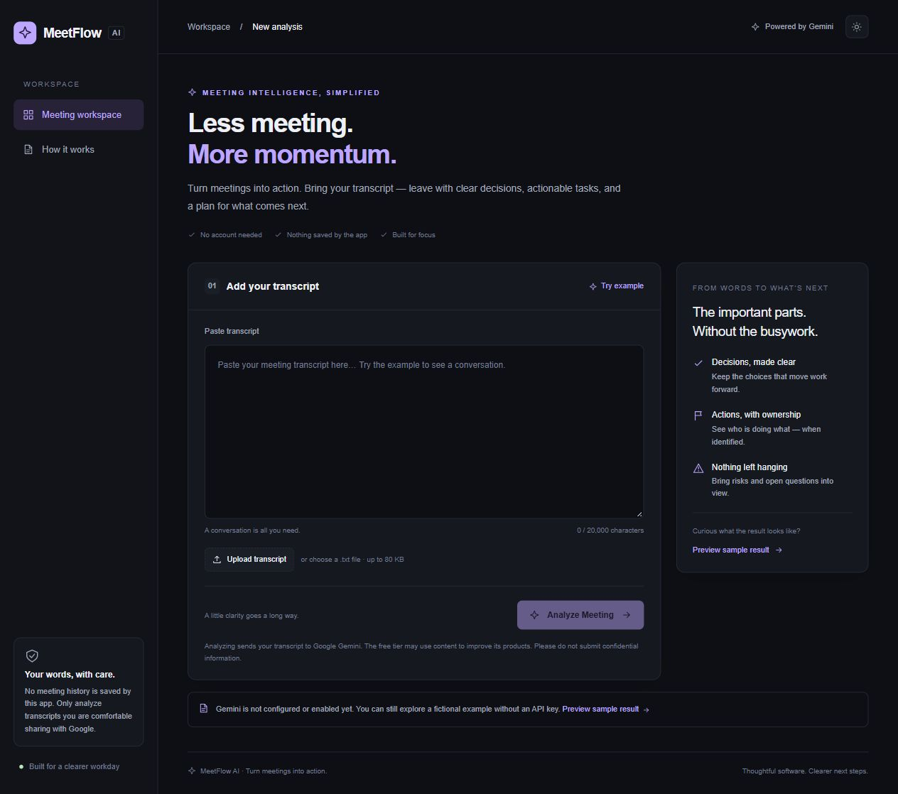
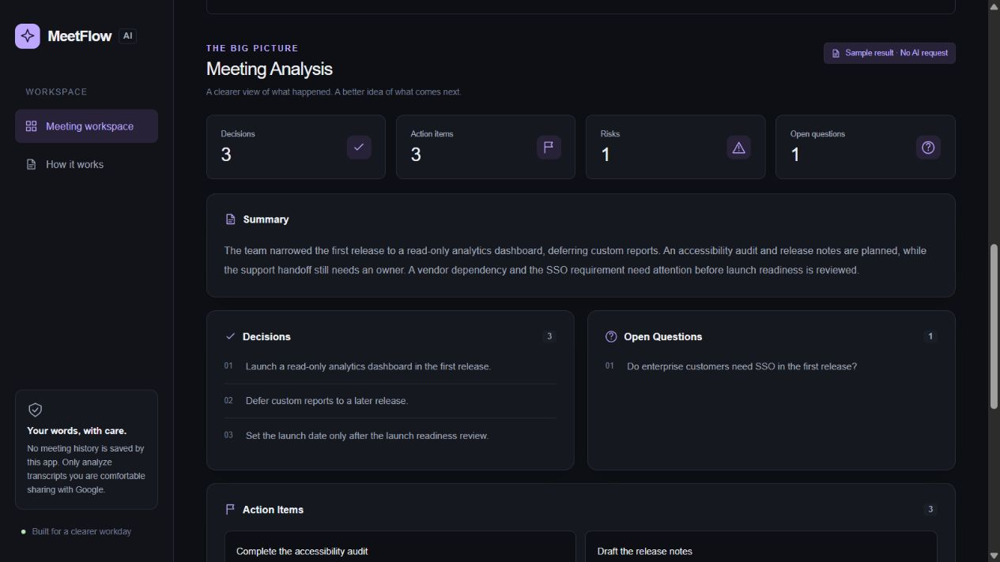
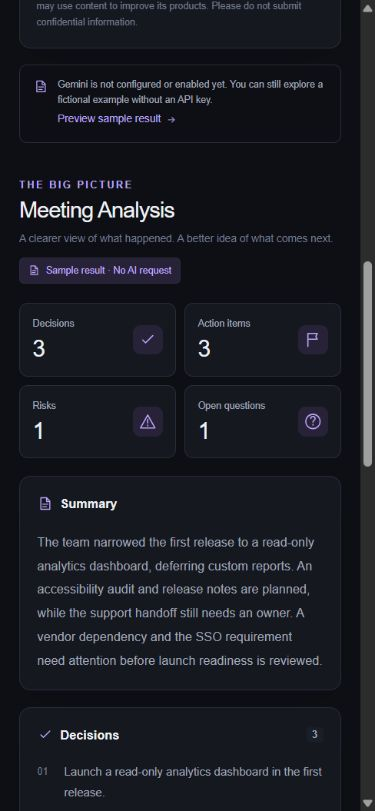
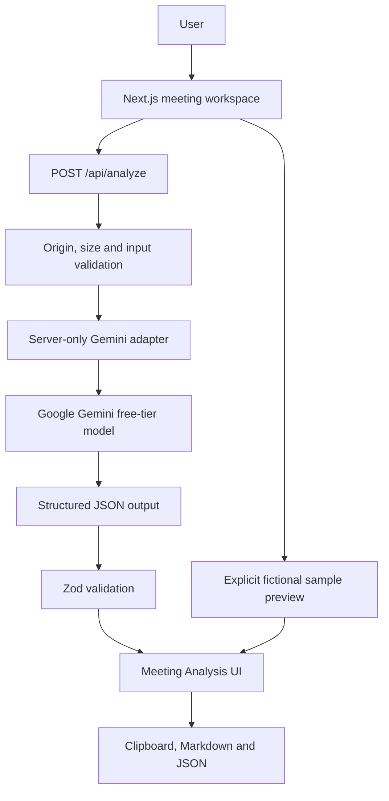

# MeetFlow AI

**Turn meetings into action with AI.**

A focused meeting workspace built with Next.js, TypeScript and Gemini. Paste a transcript, extract the important parts, and leave with a clear plan. A portfolio project at the intersection of AI Engineering and Software Engineering.

> Runs locally as a web app. Real AI analysis sends your transcript to Google Gemini; it is **not local inference**. The latest project direction uses Gemini's free tier instead of Ollama.

## Overview

MeetFlow AI turns a meeting transcript into a summary, decisions, action items, risks, open questions and next steps. It validates structured model output before rendering it and keeps unknown owners, priorities and deadlines unknown.

No account, database, paid subscription or cloud deployment is needed. Real analysis requires your own eligible free-tier Gemini API key with billing **off**. You can explore the interface and exports without a key using the clearly labeled fictional sample.

## Problem

Useful decisions and commitments are easy to lose in a long meeting transcript. Manually turning those conversations into follow-up notes takes time, while unstructured AI output can hide missing information.

## Solution

One simple flow: add a transcript, analyze it, review structured results and export the next steps. Strict schemas check the response format; explicit nulls make uncertainty visible. Human review remains essential: schema validation does not guarantee factual accuracy.

## Features

- Paste text or upload a UTF-8 .txt transcript.
- Structured summary, decisions, tasks, owners, priorities, deadlines, risks, open questions and next steps.
- A realistic fictional transcript plus a prewritten sample preview that makes no AI request.
- Illustrative processing stages, helpful empty states and clear errors.
- Responsive dark/light interface, keyboard focus, accessible status announcements and reduced-motion support.
- Copy Summary, Copy All, Export Markdown and Export JSON.
- Server-only Gemini adapter, timeout, bounded input/output, strict Zod validation and no automatic retries or paid fallback.
- No transcript history or analytics implemented by this app.

## Screenshots

Real screenshots of the locally running application. Results shown are the labeled fictional sample, not evidence of a live Gemini call.







## Architecture

A single application, without a database or an extra backend service.



## How It Works

1. Text is normalized and validated; uploaded files are decoded locally in the browser.
2. Analyze Meeting sends the transcript to the local Next.js route.
3. The server checks configuration, validates input and submits one Gemini request with a system instruction and JSON Schema.
4. The response must be complete, valid JSON and match the strict Zod schema.
5. React renders the analysis as text. Exports are generated in the browser from the validated result.

The system prompt treats the transcript as untrusted data, forbids following embedded instructions, and requests facts explicitly supported by the conversation. This reduces risk; it cannot eliminate hallucination or prompt injection.

## Tech Stack

| Area | Choice |
| --- | --- |
| Application | Next.js 16, App Router, React |
| Language | TypeScript, strict mode |
| Styling | Tailwind CSS 4 and custom CSS, system fonts |
| AI | Gemini Developer API through native server-side fetch |
| Contract | Zod 4 and generated JSON Schema |
| Tests | Vitest 5 |
| Quality | ESLint, TypeScript, Prettier |
| Package manager | npm with committed lockfile |

## Gemini / Free Tier

Default model: **gemini-2.5-flash**. The smaller **gemini-2.5-flash-lite** is the other allowed setting. The server rejects other models rather than silently falling back to a paid option.

Both are listed with free-tier input/output in the [official pricing documentation](https://ai.google.dev/gemini-api/docs/pricing) consulted on November 2, 2026. Availability, quotas and terms can change. Keep your AI Studio project on the free tier with billing off; the app cannot determine the billing state from an API key. When a quota is exhausted, it reports the error and does not retry automatically.

Create your own key through [Google AI Studio](https://aistudio.google.com/apikey). No key, account or billing configuration is created by this project. Do not enable billing to run this MVP. If the free tier is unavailable to your account, use the sample preview.

**Privacy:** real analysis sends the transcript to Google. Free-tier content may be used to improve Google's products under its terms. Do not submit confidential, personal or sensitive meeting material. No transcript is intentionally persisted or logged by this application; Google and your browser/OS operate under their own policies. Downloaded exports remain on your device.

See [structured output documentation](https://ai.google.dev/gemini-api/docs/structured-output) and the [generateContent API reference](https://ai.google.dev/api/generate-content).

## Getting Started

Prerequisites: **Node.js 24 LTS** (or a supported Node version >=26), npm and a modern browser. Node 20 is insufficient for the installed test tooling.

```bash
npm ci
npm run dev
```

Open [http://127.0.0.1:3000](http://127.0.0.1:3000). Choose **Preview sample result** to explore without credentials. **Try example** only fills the editor; **Analyze Meeting** is a real provider request when configured.

To enable real analysis:

1. Copy .env.example to .env.local (PowerShell: Copy-Item .env.example .env.local).
2. Add your own free-tier GEMINI_API_KEY and set MEETING_ANALYSIS_ENABLED=true.
3. Restart the development server.
4. Analyze only a non-sensitive transcript you are comfortable sending to Google.

To run an optimized build locally:

```bash
npm run build
npm start
```

Both dev and start bind to loopback. This is a local portfolio MVP, not a public multi-user service.

## Environment Variables

| Variable | Default | Purpose |
| --- | --- | --- |
| GEMINI_API_KEY | empty | Server-only AI Studio key. Never use a NEXT_PUBLIC_ prefix. |
| GEMINI_MODEL | gemini-2.5-flash | Allowed: gemini-2.5-flash or gemini-2.5-flash-lite. |
| MEETING_ANALYSIS_ENABLED | false | Explicit opt-in before any Gemini request. Only the string true enables it. |
| GEMINI_TIMEOUT_MS | 45000 | Timeout from 1000 to 90000 ms. |
| NEXT_TELEMETRY_DISABLED | 1 in example | Disable Next.js development/build telemetry locally. |

.env.local is ignored. Never commit keys or real transcripts. To reverse activation, set MEETING_ANALYSIS_ENABLED=false and restart. There are no migrations or stored meeting records to undo.

## Running Tests

```bash
npm run lint
npm run typecheck
npm test
npm run build
```

Tests cover schema validation, unknown/null fields, transcript normalization, file constraints, Markdown output, and the HTTP route with the external fetch boundary mocked. Route coverage includes malformed JSON, limits, disabled/missing configuration, cross-origin requests, unavailable models, quota, timeouts, blocked/truncated/invalid output and safe errors. Tests do not call Google or require an API key.

Run npm run check to execute lint, typecheck, tests and build in sequence, stopping at the first failure.

Use npm run test:watch during development and npm run format to format source/configuration. Validation evidence and review reports are versioned under .scratch/meetflow-mvp/.

**Live Gemini verification is pending:** no API key was supplied during implementation. The interface and server integration are tested locally with mocked provider responses; the sample preview is a fixture, not an AI-quality benchmark.

## Project Structure

```text
src/
  app/                       # App Router page, layout and API route
    api/analyze/             # HTTP contract and integration tests
  components/                # Small shared SVG icon component
  features/meeting-analysis/ # Workspace, results, schema, input, example, exports
  lib/
    gemini/                  # Server-side configuration and adapter
    analysis-error.ts        # Safe application errors
    read-limited-text.ts     # Bounded stream reader
.scratch/meetflow-mvp/        # Spec, tickets, reviews and retrospective
docs/agents/                # Persistent local workflow configuration
docs/screenshots/           # Real local captures
```

## API

POST /api/analyze accepts application/json with a single transcript string. Success returns {success:true,data:MeetingAnalysis}; failures return {success:false,error:{code,message}}. Responses use Cache-Control: no-store. No raw provider errors or stack traces are returned.

| Status | Meaning |
| --- | --- |
| 400 | Invalid input or JSON |
| 403 | Cross-origin request |
| 413 | Transcript or request too large |
| 415 | Unsupported content type |
| 429 | Provider quota or another analysis in progress |
| 502 | Invalid, incomplete or blocked model response |
| 503 | Disabled/missing configuration, model access or provider unavailable |
| 504 | Gemini timeout |

## Technical Decisions

- One Next.js app keeps the local setup small. React never receives the API key or calls Gemini directly.
- Native fetch avoids an unnecessary AI SDK dependency. The adapter owns prompts, timeout and provider errors.
- Zod is the source for the runtime contract and JSON Schema. Unknown fields and missing nullable attributes are rejected.
- No database: no migrations, indexes, query fan-out or history to maintain. One external request per analysis.
- No automatic retry, model fallback, paid grounding, tools or paid caching.
- Features enter behind a server flag that defaults off. The sample is a separate explicit action.
- Markdown escapes model-supplied syntax/HTML; React renders strings rather than injecting HTML.
- System fonts avoid a remote font dependency during build and normal use.

## Limitations

- Model output may be inaccurate despite structural validation. Review the transcript before acting.
- Free-tier quotas, region/account eligibility, latency and availability are controlled by Google.
- Input is limited to 20,000 characters and .txt files up to 80 KB; request bodies are capped at 100 KB and provider responses at 256 KB. Longer meetings need excerpts.
- Only one analysis at a time per server process. This is not distributed rate limiting; public exposure needs authentication/abuse controls and a privacy review.
- No persistence: refreshing discards the current workspace. Use exports to keep results.
- Progress stages are illustrative, not telemetry from the model.
- Clipboard/download permissions depend on your browser. Export buttons remain an alternative to clipboard access.
- Development tooling inherits a moderate minimatch advisory ([GHSA-g3hv-75wg-m249](https://github.com/advisories/GHSA-g3hv-75wg-m249)); the production-only npm audit returned zero vulnerabilities. A breaking forced downgrade was not applied. Recheck tooling advisories when updating dependencies.
- In this restricted Windows environment, the first sandboxed Turbopack build failed to spawn a CSS worker; the same build passed when local subprocess permissions were allowed.

## Roadmap

Future possibilities, intentionally not implemented:

- PDF export
- Audio transcription
- Meeting history
- Trello and Jira integration
- Microsoft Teams and Google Meet integration
- Multiple languages
- Speaker identification
- Public-hosting authentication, abuse protection and privacy controls

## License

[MIT](LICENSE) for this project's code. Dependencies and Google's API remain subject to their own licenses and terms.
